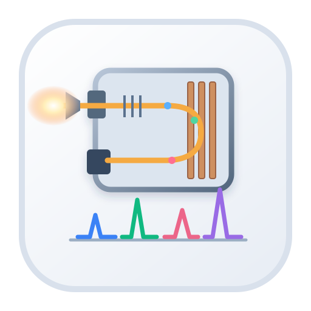

# LA–ICP–ToF–MS study notes

Study notes on the physical fundamentals of laser-ablation inductively coupled plasma time-of-flight mass spectrometry (LA–ICP–ToF–MS): laser–matter interaction, aerosol transport, plasma ionisation, time-of-flight separation, detectors, interferences, calibration and geochronological interpretation.

**Read the site:** https://duserzym.github.io/la-icp-tof-ms-notes/

Instrument-specific details marked in the text come from the **2026 GSA Connects short course on ToF**. Everything else is an independent synthesis of the cited literature and manufacturer documentation. Numerical examples marked *synthetic* are teaching calculations, not measurements of any laboratory's instrument.

## Interactive models

**[Open the new explodable ToF 3D page](https://duserzym.github.io/la-icp-tof-ms-notes/3d/)**. Source is in [`viewer/`](viewer/), with the shared visual style and controls from the TIMS and LA-ICP-MS projects. The study notes and offline viewers remain available.

- [`docs/figures/Instrument-3D.html`](docs/figures/Instrument-3D.html): folded ToF path, reflectron (tracers and noisy ensemble), H₂/He collision cell, argon blanker, MagneTOF detector.
- [`docs/figures/Laser-3D.html`](docs/figures/Laser-3D.html): absorption, spontaneous and stimulated emission, two-volume ablation cell with computed gas and particle paths.

Both are self-contained (Three.js r160 bundled, MIT license in [`docs/figures/Threejs-LICENSE.txt`](docs/figures/Threejs-LICENSE.txt)) and open offline in any WebGL browser.

## Build locally

For the Vite 3D page (Node.js 22+):

```bash
cd viewer
npm ci
npm run dev
npm test
# Run mkdocs build from the repository root first, then:
npm run build       # writes ../site/3d without replacing the notes
```

For the study notes:

```bash
pip install -r requirements.txt
mkdocs serve
```

Figures 11 and 12 are regenerated with `python3 docs/figures/tof_arrival_leakage.py` (needs NumPy and Matplotlib).

The ablation-cell flow model, figure 13 and the cell paths embedded in `Laser-3D.html` are regenerated with `python3 docs/figures/cell_flow_model.py` (needs NumPy, SciPy, pyamg and Matplotlib; about a minute). Add `--sweep` for the design-sensitivity table in note 02.

## License

[MIT](LICENSE) for the notes, figures, scripts and viewers in this repository. Bundled Three.js r160 keeps its own MIT license ([`docs/figures/Threejs-LICENSE.txt`](docs/figures/Threejs-LICENSE.txt)); the NIST isotope table is U.S. Government data.

## Third-party material

Manufacturer artwork (Nu Instruments / AMETEK) and historical journal figures are **linked, not reproduced**. Cited datasheet values, rate constants and published figures of merit belong to their sources. The notes are not an instrument operating procedure.
