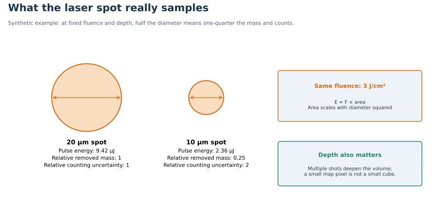

# Laser ablation and particle production

[Home](index.md) · [Previous](01-the-measurement-chain.md) · [Next](03-aerosol-transport-and-temporal-resolution.md)

**Goal:** distinguish “where material was removed” from “which material became detected ions.” Suggested study time: 10 minutes.

## Three ways light interacts with matter

**Added 16 October 2026.** Every laser–matter step in LA-ICP-MS rests on three radiative processes between a lower level $E_1$ and an upper level $E_2$, with photon energy $h\nu=E_2-E_1$. Open the paired models in [Laser-3D.html](figures/Laser-3D.html). Each process has an atom view on the left and, on the right, the place in the instrument where it matters.

| Process | What happens | Rate per volume | Where it matters in LA |
|---|---|---|---|
| **Absorption** | Photon disappears; electron goes $E_1\to E_2$ | $B_{12}\,\rho(\nu)\,N_1$ | At the **sample**: deposits the pulse energy that heats and breaks the lattice |
| **Spontaneous emission** | Electron drops $E_2\to E_1$ after a random wait; one photon, random direction and phase | $A_{21}\,N_2$ | In the **plume**: incoherent glow (what LIBS measures); in the laser it seeds the cascade |
| **Stimulated emission** | Incoming photon triggers the drop; the new photon copies its direction, phase, frequency and polarization | $B_{21}\,\rho(\nu)\,N_2$ | In the **laser cavity**: amplifies light into the coherent pulse |

Here $\rho(\nu)$ is the spectral energy density of the light and $N_i$ the level populations. Einstein's relations connect the coefficients:

$$g_1B_{12}=g_2B_{21},\qquad \frac{A_{21}}{B_{21}}=\frac{8\pi h\nu^3}{c^3}.$$

[HyperPhysics: quantum processes](https://hyperphysics.gsu.edu/hbase/mod5.html)

**Two consequences:**

1. **Gain needs population inversion.** Stimulated emission beats absorption only when $N_2/g_2>N_1/g_1$. In the model, drag the upper-level fraction below 0.5 and the light dies out. In an **ArF excimer** laser (193 nm), the emitting ArF* state is bound but the ground state is repulsive and dissociates almost at once. The lower level stays nearly empty, so inversion is automatic once ArF* forms.
2. **UV lasers fight spontaneous emission.** $A_{21}/B_{21}\propto\nu^3$, so at UV wavelengths spontaneous decay drains the upper level quickly. That is one reason ablation lasers are pulsed and short-lived inversions are pumped hard.

**At the sample: photon energy versus band gap.** A 193 nm photon carries **6.42 eV**; a 213 nm photon (Nd:YAG fifth harmonic) carries **5.82 eV**. Minerals with a smaller band gap absorb in a thin surface layer, giving controlled, shallow ablation. Wide-gap minerals such as **quartz (~9 eV)** or fluorite cannot absorb a single photon across the gap. Absorption then relies on defects, impurities or two-photon processes, so light penetrates deeper and removal is less controlled. The absorption model has a band-gap slider for this case. Which laser the system uses (193 or 213 nm) should be recorded.

## Two-volume ablation cell (TwoVol3-type)

**From the 2026 GSA Connects short course on ToF:** the demonstrated system uses a **TwoVol3** two-volume cell, described as giving a fast, about **1 ms** single-pulse response. The cell mode of [Laser-3D.html](figures/Laser-3D.html) shows the concept. It is a schematic, **not** manufacturer CAD, and its gas paths are drawn, not computed.

**Why two volumes are fast.**

- **Outer chamber.** A large chamber holds many samples and has its own flush.
- **Inner cup.** A small cup sits just above the ablation site, under a window.
- **Exit path.** A He jet sweeps the plume straight from the cup into a short, narrow exit.

The aerosol never mixes into the big volume, so the volume it must wash out of is tiny. A conventional single-volume cell instead fills and recirculates; the compare toggle shows the difference.

**Published numbers:**

- One two-volume design with an integrated dual concentric injector (DCI) measured **1.5 ms FWHM, 3.2 ms at 10% and 4.9 ms at 1%** of maximum on NIST 612. [Loughborough repository](https://dspace.lboro.ac.uk/2134/19620)
- Conventional cells take roughly **0.5–30 s** to wash out. Low-dispersion designs bring single-pulse signals below about 30 ms. [Critical evaluation, open PDF](https://digibuo.uniovi.es/dspace/bitstream/10651/52491/1/Critical%20evaluation.pdf)
- An instrument-facility page describes the TwoVol3 with a DCI as giving **<1 ms** washout. That is a vendor-style claim, not an independent measurement. [Facility page](https://qbeam.ehi.msu.edu/instruments/laser-ablation-page)

**Response width is not transport delay.** The ms figure is the *width* of one pulse's signal. The tubing adds a *delay* that shifts the signal without necessarily broadening it. For a 1 m × 1 mm tube at 1 L min⁻¹ the mean gas speed is 21 m s⁻¹:

- the plug-flow delay is 47 ms;
- under laminar flow, the first aerosol arrives on the centreline at twice the mean speed, after 24 ms.

The cell model includes this calculator. Long or sharply bent tubing still degrades washout (see [note 03](03-aerosol-transport-and-temporal-resolution.md)).

**What a ~1 ms response buys:** single pulses stay separated to the 1% level up to about 200 Hz (1/4.9 ms). That is what makes pulse-resolved imaging with a fast ToF possible: each laser pulse becomes one pixel without smearing into the next.

**Later:** a computational flow model of the chamber (streamlines, recirculation, particle residence-time distribution) would replace the drawn paths with computed ones.

## Energy density rather than pulse energy alone

For a circular top-hat beam of diameter $d$ and pulse energy $E_p$,

$$F=\frac{E_p}{\pi(d/2)^2}.$$

$F$ is fluence, commonly J cm$^{-2}$. Approximate pulse-averaged irradiance is $F/\tau_p$, where $\tau_p$ is pulse duration. A real beam’s profile and the sample’s absorptivity matter; the nominal number at the software panel is not the absorbed energy everywhere in a crater.

**Synthetic example:** a 20 μm spot at 3 J cm$^{-2}$ requires about 9.4 μJ per pulse. Holding that pulse energy while halving diameter raises fluence fourfold. Changing spot size without rechecking fluence can therefore change the ablation regime, rather than only spatial resolution.

The optical penetration scale is approximately $\delta=1/\alpha$ for absorption coefficient $\alpha$. A thermal diffusion scale over a pulse is $\ell_{\rm th}\sim\sqrt{D\tau_p}$, with thermal diffusivity $D$. These are intuition-building length scales, not a complete crater model. Shorter pulses allow less thermal diffusion during irradiation; real ablation also involves plasma shielding, phase change, stress, defects, and changing optical coupling.

## Diagram: Laser footprint and counts

Synthetic comparison at fixed fluence, density and removed depth. Actual particle production and efficiencies can change with spot size.

## The ablated plume is chemically structured

A pulse can generate vapour, condensate, melt droplets, and fragments. These need not have identical composition. Some material is deposited around the crater; some sticks to surfaces during transport; some particles are incompletely processed in the ICP. “Ablated composition equals bulk composition” is an experimental hypothesis.

Guillong and Günther’s 2002 experiments demonstrated that particle-size distributions and incomplete processing of larger aerosol fractions could change elemental ratios. Their particular comparisons involved 266 and 193 nm ablation and instrument-dependent behaviour. Do not turn this into a universal particle-size cutoff or a guarantee that any UV system is fractionation-free. [Primary study](https://doi.org/10.1039/B202988J)

An unusually relevant extension is the 2026 single-particle LA-ToF study by Adamson et al. The publisher’s highlights report differences in particle size and composition between reference zircons and Pb-rich material associated with deposition near craters. This directly connects ToF to diagnosing analytical U–Th/Pb bias. The accessible abstract/highlights do not justify treating one mechanism as the explanation for every zircon or laser condition. [Primary paper](https://doi.org/10.1016/j.chemgeo.2026.123325)

## Why repeated pulses differ from a line scan

A stationary spot deepens. Its aspect ratio, coupling, redeposition, and escape geometry evolve. A line scan continually encounters fresher surface, but can change minerals and topography. Equal nominal fluence does not make the two sampling modes equivalent.

A September 2026 zircon study by Davis and Rochin-Banaga proposes a model involving Pb volatility, melt, and fallback; it also stresses limitations in deriving bias-free ratios from an underconstrained model. Read it alongside the Adamson paper as active mechanistic work, rather than assuming matrix effects are fully solved. [Open primary paper](https://gchron.copernicus.org/articles/8/529/2026/)

## Spatial resolution has an information cost

For a cylindrical removed volume,

$$m_{\rm removed}=\rho\pi(d/2)^2h.$$

At fixed depth $h$, halving diameter gives one-quarter the removed mass and approximately one-quarter the counts if efficiencies stay fixed. Ideal counting relative uncertainty then doubles. If depth is also halved, counts fall eightfold and relative uncertainty rises by $\sqrt8$.

Multiple shots can recover counts, but deepen the sampled volume. A 2 μm map pixel is not proof of a 2 μm isotropic sampling volume. Inspect crater depth, overlapping shots, and whether a pixel averages material along a line or through depth.

**Questions for the lab:** What is the measured ablation depth per shot on each relevant mineral? What does pre-ablation remove? Are standards and unknowns sampled with the same geometry, pulse history, and fluence? Is the smallest defensible feature set by beam diameter, transport, or counts?

Related: [03 Aerosol Transport and Temporal Resolution](03-aerosol-transport-and-temporal-resolution.md), [09 Geochronology Petrochronology and Rock Magnetism](09-geochronology-petrochronology-and-rock-magnetism.md).

Extension: [17 Sample Introduction Beyond Laser Ablation](17-sample-introduction-beyond-laser-ablation.md).
