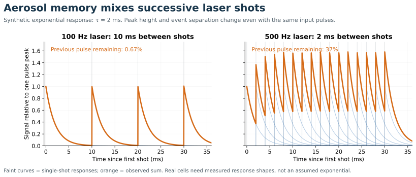

# Aerosol transport and temporal resolution

[Home](index.md) · [Previous](02-laser-ablation-and-particle-production.md) · [Next](04-plasma-interface-and-ion-optics.md)

**Goal:** understand why the sample introduction system often controls what “fast” actually means. Suggested study time: 10 minutes.

## Delay and broadening are different

A perfectly narrow pulse delayed by 0.5 s is still narrow. A pulse that arrives over 0.5 s has lost temporal localization. For maps, a stable delay can be corrected by synchronization. A broad or variable response causes mixing and is harder to undo.

Gas flow carries particles out of the cell and through tubing. Geometry, recirculation, dispersion, particle inertia, deposition, bends, and injector conditions affect their transit. Helium is commonly used in the ablation cell, with argon added for plasma introduction; exact arrangements are system-specific. [Official LA introduction guidance](https://icp-ms.help.agilent.com/en/HowTo/Help/Reference/Laser_Ablation_for_ICP-MS.htm)

The ESL–Vitesse technical note specifically warns that long or sharply bent transfer tubing degrades washout and describes shot-trigger synchronization. This is useful evidence that gas transport and timing are integral parts of an imaging system, not accessories. It is a technical installation document, not a request to adjust instrument hardware. [Official technical note](https://iolite.xyz/docs/_downloads/d772fcc89f8c6c4ebbd49e58c011b3a1/TvTuner_ESL_Vitesse_Guide.pdf)

## The simplest impulse response

Use an exponential tail as a teaching model:

$$h(t)=\frac{1}{\tau}e^{-t/\tau},\qquad t\geq0.$$

Its area is 1. For pulses separated by $T=1/f_L$, the earlier pulse’s response has fallen to $e^{-T/\tau}$ of its initial value when the next pulse starts.

**Synthetic example:** at $\tau=2$ ms and 100 Hz, $T=10$ ms and the residual fraction is $e^{-5}=0.0067$. At 500 Hz, $T=2$ ms and it is $e^{-1}=0.368$. The faster laser can produce much stronger overlap unless the response is shortened. Real plumes have rise times, multiple components, and non-exponential tails; measure them rather than assuming this shape.

Always ask which width is quoted: FWHM, full width at 1% maximum, time to background, or another definition. Two “1 ms” specifications using different definitions need not describe equivalent washout.

## Diagram: Aerosol washout and overlapping shots

The response curves use the exponential teaching model in this note. They are not measured cell performance.

## Spatial blur is a time-domain problem

For a continuous line scan at velocity $v_s$,

$$\Delta x_{\rm sampling}=v_s\Delta t_{\rm output},\qquad
\ell_{\rm tail}\sim v_s\tau.$$

The first is spacing between saved samples; the second is a characteristic transport smear length. Neither by itself is the optical spot diameter. A small output pixel can oversample a much wider effective point-spread function.

If several broadening mechanisms are approximately Gaussian and independent, their variances add. This can be a useful approximation, but an asymmetric washout tail is not Gaussian: it leaves directional smearing that a single “resolution” number hides.

## What is conserved, and when

A normalized linear response redistributes a pulse in time while conserving its integrated area. Thus integrating the full transient can recover total counts even when peak height and apparent timing change. Real transport can also lose material, so area conservation must be tested. Truncated windows discard tails; matrix-dependent tails can bias ratios if different channels are integrated inconsistently.

Burger et al. demonstrated pulse-resolved LA-ToF imaging with a low-dispersion cell, including 5 μm spots and aerosol pulses confined to less than 10 ms in their 2017 setup. Those are published conditions, not a universal ToF specification. [Primary study](https://doi.org/10.1039/C7JA00236J)

**Diagnostic experiment:** traverse a sharp compositional boundary in both scan directions. If the tail reverses with scan direction, transport or reconstruction is implicated. Repeat at a slower stage speed, check the trigger offset, and inspect the raw time series before assigning the pattern to diffusion or alteration.

Related: [07 Simultaneity Duty Cycle and Mapping](07-simultaneity-duty-cycle-and-mapping.md), [10 From Raw Data to a Defensible Result](10-from-raw-data-to-a-defensible-result.md).

Extension: [17 Sample Introduction Beyond Laser Ablation](17-sample-introduction-beyond-laser-ablation.md).
