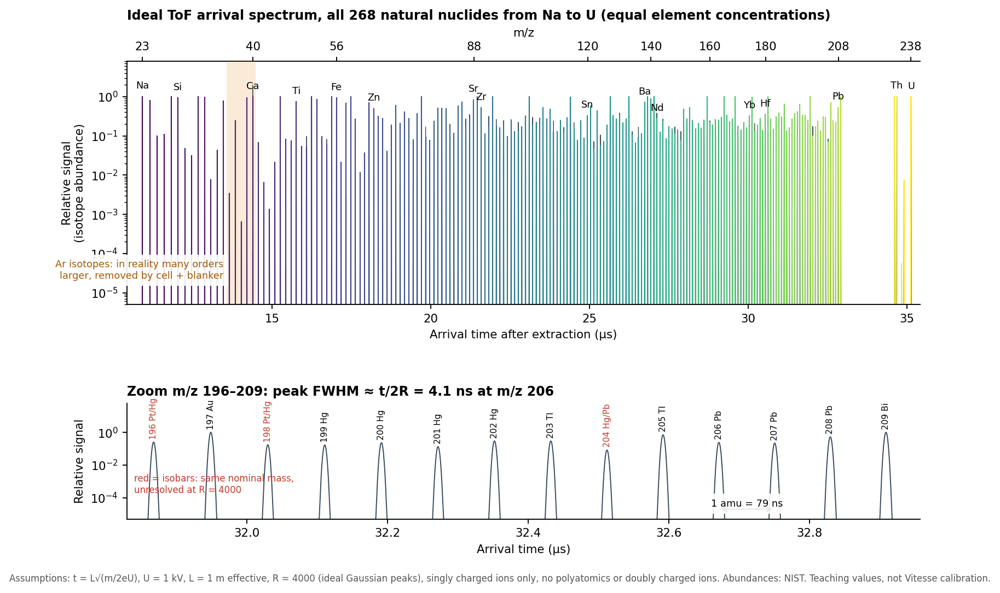
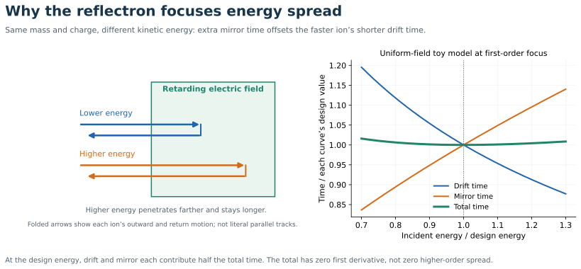

# Time of flight from first principles

[Home](index.md) · [Previous](04-plasma-interface-and-ion-optics.md) · [Next](06-detectors-noise-and-interferences.md)

**Goal:** derive the instrument’s mass axis and identify what broadens a mass peak. Suggested study time: 18 minutes.

## Step 1  Accelerate through a potential

An ion with charge $q=ze$ gains kinetic energy $qU$ through a potential difference $U$. For negligible initial kinetic energy in the analyzed direction,

$$\frac12mv^2=zeU\quad\Longrightarrow\quad
v=\sqrt{\frac{2zeU}{m}}.$$

Ions of the same charge receive the same energy, not the same speed. A doubly charged ion receives twice the energy of a singly charged ion at the same potential.

## Step 2  Time a field-free flight

For flight distance $L$,

$$t_f=\frac{L}{v}=L\sqrt{\frac{m}{2zeU}},\qquad
\frac{m}{z}=\frac{2eU}{L^2}t_f^2.$$

A real instrument contains finite acceleration regions, mirrors, delays, and nonidealities. A basic calibration is therefore written

$$t=t_0+a\sqrt{m/z},\qquad m/z=\left(\frac{t-t_0}{a}\right)^2.$$

Units are absorbed into $a$: masses expressed in Da per charge require the corresponding conversion. Real software may use additional calibration terms. Use several known peaks across the mass range and inspect residuals rather than simply trusting a visually plausible mass axis.

**Synthetic example:** with $L=1$ m and $U=5$ kV, ideal singly charged flight times are approximately 7.62 μs for mass 56, 14.61 μs for mass 206, and 15.71 μs for mass 238. These are straight-flight teaching values, not a particular instrument’s path or voltage.

## Step 3  Make a start time from a continuous beam

The ICP is a continuous source even when its aerosol input is transient. An orthogonal accelerator repeatedly pushes a short segment of that beam sideways into the ToF path. The extraction trigger supplies the start time. Orthogonal geometry helps separate the mass-analysis direction from much of the incoming beam’s axial motion, but initial position, velocity spread, and angular divergence still matter.

Classic work by Wiley and McLaren developed spatial/time focusing of ions with different starting positions. This is the conceptual ancestry of compensating initial conditions rather than merely measuring time more accurately. [Original 1955 paper](https://masspec.scripps.edu/learn/ms/pdf/1955_WileyWC.pdf)

## Original literature diagram: mass-reflectron

*Figure not reproduced here: see Figure 1 of [Mamyrin et al. (1973)](https://www.jetp.ras.ru/cgi-bin/dn/e_037_01_0045.pdf), printed page 46.* I = ion source; DP = deflecting plates; RS = reflecting system; SEM = electron multiplier. This is a historical mass-reflectron, not an ICP source or a Nu Vitesse drawing. Trace the two drift legs and the electrostatic mirror. [Original paper](https://www.jetp.ras.ru/cgi-bin/dn/e_037_01_0045.pdf).

Explore the clickable components and original sources in [15 Instrument Illustrations](15-instrument-illustrations.md).

## Step 4  Understand resolution from timing

Differentiate $m\propto(t-t_0)^2$ for a narrow peak:

$$\frac{\Delta m}{m}\simeq\frac{2\Delta t}{t-t_0},\qquad
R\equiv\frac{m}{\Delta m}\simeq\frac{t-t_0}{2\Delta t}.$$

Use the same peak-width convention on both axes, commonly FWHM. At effective flight time 20 μs and temporal FWHM 2 ns, $R\approx5000$. A 10 ns width would give only about 1000. This shows why extraction, focusing, detector pulse shape, digitizer sampling, and timing stability all matter.

A longer path increases flight time and potentially separation, but transmission, pulse spreading, maximum repetition rate, and stability can impose costs. Merely making the instrument longer does not guarantee proportional performance improvement.

### Arrival times across the chart of nuclides, Na to U

**Added 16 October 2026. From the 2026 GSA Connects short course on ToF:** the Vitesse orthogonal-accelerator **pusher pulse is about 1 kV**. Below, 1 kV is treated as the whole energy per charge. If further acceleration stages follow the pusher, the real ion energy is higher and every time below shrinks by $\sqrt{U_{\rm pusher}/U_{\rm total}}$. The effective path $L=1$ m is the same teaching value used in the 3D viewer, not the Vitesse folded-path length.

All **268 natural nuclides from Na to U** (NIST abundances, [nuclides-Na-U-NIST.csv](Reference/nuclides-Na-U-NIST.csv)) are drawn as ideal Gaussian peaks at $R=4000$, with equal element concentrations so that only isotope abundance sets the heights. The zoom shows what the detector actually has to separate: peaks a few ns wide, spaced tens of ns apart. Isobars (red) such as ²⁰⁴Hg/²⁰⁴Pb share a nominal mass and are not separated at this resolving power. Generate with [tof_arrival_leakage.py](figures/tof_arrival_leakage.py).

The two timing numbers that matter follow from $t=L\sqrt{m/2eU}$:

$$\Delta t_{1\,\rm amu}\simeq\frac{t}{2m},\qquad \Delta t_{\rm FWHM}=\frac{t}{2R}.$$

| m/z | Flight time | 1 amu spacing | Peak FWHM at R = 4000 |
|---|---|---|---|
| 23 (Na) | 10.92 μs | 237 ns | 1.36 ns |
| 40 (Ar/Ca) | 14.40 μs | 180 ns | 1.80 ns |
| 88 (Sr) | 21.35 μs | 121 ns | 2.67 ns |
| 206 (Pb) | 32.67 μs | 79 ns | 4.08 ns |
| 238 (U) | 35.12 μs | 74 ns | 4.39 ns |

Separating adjacent masses is easy in time: even at U, neighbours are about 17 FWHM apart. Leakage between them is therefore set by **tails**, not by the Gaussian core. That is the subject of [leakage in note 06](06-detectors-noise-and-interferences.md#leakage-into-the-neighbouring-mass).

**Consistency check against the 200 kHz clock.** At these assumptions, ²³⁸U arrives at 35 μs, so a full Na–U spectrum allows at most about **28 kHz** extraction. A 200 kHz clock (5 μs) cannot be a full-range extraction rate at 1 kV and 1 m. One of these must hold: the real energy is higher, the effective path is shorter, the 200 kHz refers to a different clock, or it describes the restricted-mass-range high-frequency mode that the blanker enables. Record which one applies.

## Step 5  Why a reflectron works

Consider two ions of identical $m/z$ but slightly different kinetic energy. In a straight flight tube the faster ion arrives earlier. In a retarding electrostatic mirror, the faster ion penetrates farther before reversing, spending more time in the mirror. Tune the geometry so that the extra mirror time compensates the shorter drift time. This is energy focusing. Folding the flight path is an additional benefit.

For an ideal uniform-field mirror, let $L_d$ be total field-free travel, $E_r$ the retarding field magnitude, and $K$ the incident kinetic energy:

$$t(K)=L_d\sqrt{\frac{m}{2K}}+\frac{2\sqrt{2mK}}{qE_r}.$$

The first term decreases with $K$; the second increases. First-order focusing requires $dt/dK=0$ at the design energy. It gives

$$L_d=\frac{4K}{qE_r}=4d,$$

where $d=K/(qE_r)$ is the turning depth. This stripped-down derivation neglects entrance/exit fields, finite acceleration, angles, and higher-order terms. Actual reflectrons use more sophisticated fields and focusing; do not infer hardware dimensions from this toy equation.

The original Mamyrin et al. paper is a primary source for the mass-reflectron principle. [1973 paper](https://www.jetp.ras.ru/cgi-bin/dn/e_037_01_0045.pdf)

## Diagram: energy focusing in the reflectron

The graph uses the uniform-field model derived above, at its first-order focus. Each time curve is divided by its own value at the design energy; the total is therefore the average of the two normalised contributions. Arrows at left are a conceptual energy comparison, not an instrument drawing.

## Resolution is not accuracy

- **Resolving power:** width of a peak relative to its mass.
- **Mass accuracy:** closeness of its assigned mass to the correct mass.
- **Sensitivity:** signal for an amount or concentration, under specified conditions.
- **Abundance sensitivity:** how strongly a large peak contaminates neighbouring masses through its tails.

A narrow peak can have a shifted centroid; a correct centroid can belong to an unresolved mixture. A well-resolved weak analyte can still be hidden under the tail of a much larger neighbour.

**Check yourself:** does doubling charge halve flight time? No: at fixed mass and potential, it divides flight time by $\sqrt2$.

Related: [06 Detectors Noise and Interferences](06-detectors-noise-and-interferences.md), [07 Simultaneity Duty Cycle and Mapping](07-simultaneity-duty-cycle-and-mapping.md).
