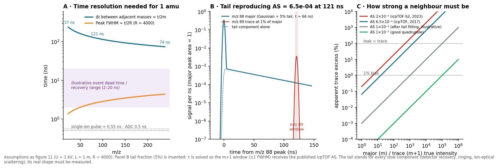
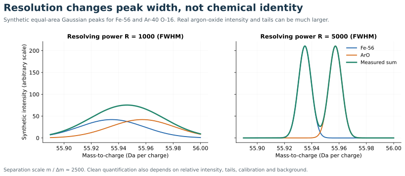

# Detectors noise and interferences

[Home](index.md) · [Previous](05-time-of-flight-from-first-principles.md) · [Next](07-simultaneity-duty-cycle-and-mapping.md)

**Goal:** separate mass separation, signal detection, and chemical identification. Suggested study time: 12 minutes.

## An ion strike becomes an electrical signal

ToF detection requires fast response to packets arriving only nanoseconds apart. Electron-multiplying detectors turn an ion strike into an electron cascade; designs include microchannel plates and magnetic electron multipliers such as the MagneTOF used on the course instrument. Readout can timestamp pulses using time-to-digital conversion (TDC), digitize an analog waveform using ADC, or combine approaches. The actual architecture matters.

A TDC may register coincident ions as one event. ADC can preserve a larger signal-amplitude range but adds electronic noise and the distribution of single-ion pulse heights. Therefore “counts” reconstructed from an analog signal need not be statistically identical to literal event counts. Gundlach-Graham and colleagues explicitly modelled these low-count ToF signal statistics. [Primary paper](https://doi.org/10.1021/acs.analchem.8b01551)

## Course instrument: MagneTOF detection and acquisition settings

**From the 2026 GSA Connects short course on ToF:** the demonstrated instrument uses a **MagneTOF electron multiplier** for signal detection, with **2 GS/s** digitization and a reported **200 kHz** rate. These are reported course settings, not specifications inferred from a detector datasheet. The exact detector part number and whether 200 kHz refers to extraction, triggering, or another acquisition clock remain to be recorded.

MagneTOF uses electric and magnetic fields to guide secondary electrons from an ion-impact surface through multiplication stages. Its output can be integrated to estimate ion numbers when individual pulses overlap. A primary characterization study demonstrated linear integrated response up to several tens of thousands of ions in approximately 700 ns FWHM bunches; this is a result for that experimental configuration, not a universal limit for every MagneTOF. [Simke et al. 2024, Evaluation of MagneTOF detector signals for the determination of many-ion bunches](https://doi.org/10.1016/j.ijms.2024.117337)

### Published detector specifications: model-specific example

The ETP **14DM572 MagneTOF Plus** datasheet gives the following values. **The installed model is not yet confirmed**, so use this table as a reference example rather than an operating specification for the course instrument.

| Property | Published 14DM572 value |
|---|---|
| Single-ion pulse width | <0.55 ns FWHM, measured DC-coupled at 3 GHz bandwidth |
| Linear pulse amplitude | Up to 2.5 V into 50 Ω |
| Sustained linear output current | 6 μA |
| Ringing after the main pulse | 2% typical, with the same measurement conditions |
| Typical new-detector gain | $10^6$ at approximately 1950 V magnitude |
| Operating bias | Approximately −1800 V initially; −3400 V maximum when aged |
| Dark counts | <50 per minute at 2600 V magnitude, with no incident ions |
| Maximum operating pressure | $10^{-4}$ Torr |
| Entrance aperture | Nominally 15 × 33 mm |
| Mechanical envelope | Nominally 45 × 52 × 96 mm, excluding mounting tabs |

[ETP 14DM572 datasheet, revision A, 21 October 2015](https://a6e5e8fc1ad706fd1969-b6eded4adeadd283a6338023bbf1f6de.r62.cf4.rackcdn.com/eecf54836514652645e0c9909cd7324f18ee5597-14DM572MagneTOFPlusDatasheet.pdf). Checked through indexed datasheet text on 10 October 2026; direct PDF retrieval timed out. The supplier's current [TOF electron multiplier page](https://lifescience.imiplc.com/product/tof-electron-multipliers) explicitly describes custom designs and typical, configuration-dependent specifications.

### What 2 GS/s and 200 kHz imply

- **2 GS/s = 0.5 ns between digitizer samples.** This specifies sampling interval; analog bandwidth, noise, and pulse fitting also control timing performance. A 0.55 ns detector pulse spans only about one sampling interval, so the detector pulse width alone does not establish the acquired waveform's resolution.
- **200 kHz = 5 μs between cycles** of whichever clock this rate describes. If it is the waveform trigger rate and sampling covers the whole interval, there would be 10,000 samples per cycle. This does not establish the actual acquisition window, retained mass range, or saved spectrum rate.
- Neither number specifies maximum ion count rate or dynamic range. Record ADC bit depth, full-scale voltage, analog bandwidth, single-ion response, gain, and accumulation settings to characterize the whole detection chain.

### Dynamic range compared with quadrupole ICP-MS

Dynamic range is the ratio of the largest linear signal to the smallest usable signal **under stated measurement conditions**. The 14DM572 datasheet specifies upper limits (2.5 V pulses and 6 μA sustained output) but does not establish a universal number of usable decades for the course digitizer and detector together. A multiplier gain of $10^6$ is amplification, not six orders of analytical dynamic range.

| Detection regime | Quantitative reference | Meaning for comparison |
|---|---|---|
| Quadrupole ICP-MS, individual-ion pulse counting | Agilent documentation places the switch to analog near 0.9–1.3 million cps, depending on configuration | Coincident pulses and counting dead time constrain this mode; the switch point is instrument-specific |
| Quadrupole ICP-MS, combined pulse/analog readout | Thermo iCAP RQ documentation gives 0.1 to >$10^9$ cps equivalent, spanning >10 orders | The upper values are calibrated analog equivalents, not billions of separately resolved ion pulses |
| MagneTOF Plus 14DM572, waveform readout | 2.5 V maximum linear pulse into 50 Ω; 6 μA sustained linear output | Both instantaneous peak size and total average detector load matter; ADC clipping can impose a lower limit |

Sources: [Agilent analysis performance terms](https://icp-ms.help.agilent.com/en/HowTo/Help/Reference/Analysis_performance_terms.htm) and [Thermo iCAP RQ linear dynamic range technical note TN43399](https://tools.thermofisher.com/content/sfs/brochures/TN-43399-ICP-MS-iCAP-RQ-Linear-Dynamic-Range-TN43399-EN.pdf). As historical context, Agilent's [2008 comparison](https://www.agilent.com/library/articlereprints/Public/5989_8396EN.pdf) describes approximately six orders for older pulse-count-only detectors and eight for conventional combined pulse/analog detectors; those are historical examples rather than limits of modern quadrupole systems.

**Illustrative conversion, not a measured instrument limit:** if the mean output charge per detected ion is $Ge$ with $G=10^6$, the 6 μA sustained-output specification corresponds to

$$r_{\rm equivalent}=\frac{I_{\rm out}}{Ge}=\frac{6\times10^{-6}}{10^6\times1.602\times10^{-19}}\approx3.7\times10^7\ \text{detected ions s}^{-1}.$$

This is an average charge-equivalent rate at the assumed gain, across **all ions hitting the detector**, not a per-isotope pulse-count limit. Concentrating that charge into narrow ToF peaks can exceed the pulse-amplitude limit even below the average-current limit. At an assumed 200 kHz extraction rate it would average approximately 190 detected ions per extraction across the spectrum, but that interpretation requires confirming what the reported 200 kHz clock means.

For major/trace-element measurements, quadrupoles can extend range by cross-calibrating pulse and analog modes for each selected mass. ToF sends successive mass peaks to the same detector within each spectrum, so intense matrix peaks, saturation recovery, and ADC headroom matter for trace peaks nearby in time. Nu's [Vitesse brochure](https://www.nu-ins.com/-/media/ameteknuinstruments/files/products/brochures/vitesse_2021.pdf?la=en&revision=9003d984-cc91-4469-b999-c03acd38b8ae) identifies a MagneTOF detector and a physical ion-beam attenuator for extending working range, but gives no numerical detector dynamic-range ratio. Establish the usable range with standards, single-ion charge calibration, and raw peak-linearity checks at the actual gain and acquisition settings.

## Inside MagneTOF: why the electrical pulse can be so short

**Added 10 October 2026.** Open **MagneTOF cutaway** in [the 3D viewer](15-instrument-illustrations.md), or select the detector in the instrument overview. The exploded view separates the housing, magnetic pole pieces and field-shaping electrode so the impact surface, receiving dynodes, multiplier and anode can be inspected. These are schematic components; their material composition and exact installed geometry are not established here.

### Conversion, electron focusing and multiplication

A sufficiently energetic ion strikes the conversion surface and releases secondary electrons. Their signal must travel from a broad impact area into a smaller amplification region without adding much timing dispersion. Crossed electric and magnetic fields guide curved electron trajectories and focus them. The patent describes approximately 270° deflection in its first focusing stage, progressively smaller receiving dynodes, and subsequent amplification; this illustrates the design principle rather than proving the construction of the course instrument's detector. [ETP patent US6982428B2](https://patents.google.com/patent/US6982428B2/en)

The force law for an electron is

$$m_e\frac{d\mathbf v}{dt}=-e\left(\mathbf E+\mathbf v\times\mathbf B\right).$$

The electric field supplies kinetic energy; the magnetic force changes direction without doing work because $\mathbf v\cdot(\mathbf v\times\mathbf B)=0$. Electron impacts on emitting surfaces generate further electrons. The final electron cloud reaches the anode and produces an electrical transient. A useful gain bookkeeping expression is $G\sim\eta_{\rm transport}\prod_i\delta_i$, with stage yields $\delta_i$ and a transport factor; actual yields, efficiencies and gain fluctuate.

Fast response depends on **small spread in electron arrival times**, not simply short geometric paths. A common transit delay shifts a pulse; a distribution of delays broadens it. To first approximation, independent Gaussian broadening terms add as

$$\sigma_{\rm observed}^2\approx\sigma_{\rm ion}^2+\sigma_{\rm electron\ transport}^2+\sigma_{\rm electronics}^2.$$

The animation sends three coincident impacts at different positions through schematic focusing paths on one shared replay clock. This expresses timing coherence; it is not a numerical demonstration of the fields or a calibrated internal transit time.

### Electron timing compensation: different paths can preserve coincidence

The requirement is $t_{\rm out}=t_{\rm ion}+\tau_e$. Two ions that strike together should have nearly equal electron delays $\tau_e$, even when their impact positions differ. The detector must keep both the mean delay's dependence on impact position and the within-cascade spread small. **Spatial focusing** sends electrons to a small receiving area; **temporal focusing** makes their arrival times agree. Achieving one does not automatically achieve the other.

The relevant travel time is

$$\tau_e=\int_{\rm trajectory}\frac{ds}{v(s)}.$$

Equal path lengths are unnecessary: a longer path with a larger average speed can have the same travel time. This also differs from the reflectron's ion-energy compensation. MagneTOF shapes the transport of newly emitted electrons inside the detector; it does not undo genuine differences in the arrival times of the incident ions.

For an analytic insight, take a uniform $\mathbf E=-E\hat y$ and $\mathbf B=-B\hat z$, with electrons emitted at $(0,0)$, $v_y(0)=0$ and an initial $v_x(0)=v_0$. With $\omega=eB/m_e$ and $v_d=E/B$, integrating the Lorentz equation gives

$$x(t)=v_dt+\frac{v_0-v_d}{\omega}\sin(\omega t),\qquad y(t)=\frac{v_d-v_0}{\omega}\left[1-\cos(\omega t)\right].$$

At one gyroperiod,

$$T=\frac{2\pi}{\omega}=\frac{2\pi m_e}{eB},\qquad x(T)=v_dT,\qquad y(T)=0.$$

For these launch conditions, the return time and displacement are independent of $v_0$, although trajectory lengths and instantaneous speeds differ. The nonrelativistic magnetic rotation provides the shared time scale; the electric field sets the drift and changes kinetic energy along the path. [Crossed-field physics](https://www.feynmanlectures.caltech.edu/II_29.html#Ch29-S8)

The viewer's **Timing compensation / analytic insight** view animates precisely these equations for $v_0=0,\ 0.35v_d,\ 0.70v_d$. At the invented $B=20$ mT, the common return time is about **1.786 ns**. Increasing B shortens that time; a table shows different path lengths and identical returns. This is an internal transit-time illustration, **not a predicted output FWHM or dead time**. Drawing scale changes with B; read physical lengths from the table.

This uniform-field example starts electrons at the **same** position. Different starting positions would remain displaced after a full turn: uniform fields alone do not compress a broad impact surface into one small spot. In the actual focusing concept, electrode and pole shapes change the field distribution and the ratio $E/B^2$, contracting the electron trajectories while preserving timing. The patent's partial-turn transport is not the full-period example above. The schematic cutaway illustrates broad-area focusing; the analytic view demonstrates a timing property under restrictive launch conditions. Neither constitutes a quantitative simulation of the installed MagneTOF's position-, angle- or energy-dependent delay.

The residual electron delay distribution is convolved with the ion packet and electronics response. The aim is a narrow delay distribution, not zero delay, and not the removal of the incident ion packet's real time structure.

### Capacitors, pulse width and dead time

The charge gain comes from secondary emission. Capacitors can participate in bias support or signal coupling. The supplier specifically offers capacitor decoupling to preserve very short pulses and reduce ringing; capacitor values and construction are not established for the course detector. Output impedance, cables, bandwidth and coupling all matter to the recorded transient. [Current supplier description](https://lifescience.imiplc.com/product/tof-electron-multipliers)

Keep four timing quantities separate:

| Quantity | What it tells us |
|---|---|
| Pulse FWHM | Width of the electrical response to a single impact under stated conditions |
| Counting dead time | Interval over which the discriminator, timing circuit or event algorithm cannot register another separate event reliably |
| Overload recovery | Time for the detector/electronics to return to a usable response after excessive input |
| Sampling interval | Time between ADC measurements; 2 GS/s means 0.5 ns, independent of the above |

A subnanosecond pulse helps separate nearby arrivals, but does **not** establish subnanosecond counting dead time or an ion-count rate equal to its inverse. Concurrent electron cascades and overlapping electrical pulses are possible. Pulse identification can fail while analog charge remains additive, provided the detector and readout remain linear. Conversely, clipping or saturation can invalidate the area even if the pulses look fast.

The viewer's independent two-ion plot uses unit-area Gaussian responses. Vary separation to merge the peaks; vary sampling phase to see why a sparse ADC grid can change estimated area. For a linear chain,

$$s(t)=\sum_i h(t-t_i),\qquad \int s(t)\,dt=N\int h(t)\,dt.$$

This relation explains calibrated signal integration; it does not guarantee that a finite sampled waveform or a saturated detector preserves the integral. The dashed 2 ns response is an invented comparison, not a measured alternative detector.

### Full-paper update: Simke's conditions differ from the Plus datasheet

The [open full paper](https://epub.ub.uni-greifswald.de/files/14308/1-s2.0-S1387380624001489-main.pdf) was accessed on 10 October 2026. Simke et al. used **14DM291H**, with a **25 GS/s, 4 GHz, 8-bit** oscilloscope, and report approximately **1 ns** single-ion FWHM at 1900 V. Their roughly 700 ns bunches lost linear individual-event counting above about 90 ions under the tested threshold, while integrated response extended much farther. Their calibration is detector- and voltage-dependent. These are distinct from the **14DM572 Plus** specifications above and the reported **2 GS/s** course settings; no installed-model counting dead time has been confirmed.

## Pulse shape, and integration versus fitting

**Added 16 October 2026.**

### Is there an expected single-ion pulse shape?

Not from first principles. The recorded transient is the anode electron arrival-time distribution convolved with the readout impulse response (anode capacitance, 50 Ω line, amplifier bandwidth):

$$h(t)=p_e(t)\otimes g_{\rm electronics}(t).$$

Neither factor has a closed form for a real detector, so the shape is described phenomenologically. Common empirical choices are:

| Form | Expression (schematic) | What it represents |
|---|---|---|
| Gaussian | $h\propto e^{-(t-t_0)^2/2\sigma^2}$ | Symmetric core; adequate when the electronics are much faster than the cascade spread |
| Exponentially modified Gaussian | Gaussian $\otimes\ \tfrac1\tau e^{-t/\tau}$ | Fast rise plus exponential tail, with $\tau$ of order the output $RC$ |
| Bi-exponential | $h\propto e^{-t/\tau_d}-e^{-t/\tau_r}$ | Electronics-dominated shaping with rise $\tau_r$ and decay $\tau_d$ |
| Ringing term | small damped oscillation after the main pulse | Impedance mismatch; about 2% typical in the 14DM572 datasheet above |

These are fitting conveniences, not derived laws. Which one applies depends on the installed detector, coupling and cabling, so it must be measured from isolated single-ion events.

**At the course settings the shape is barely sampled.** A <0.55 ns FWHM pulse recorded every 0.5 ns spans about one to two samples, so fitting a shape to each individual pulse is poorly constrained. The sampling-phase effect in the two-ion plot above is the same limitation.

### Pulse size fluctuates more than pulse shape

Gain varies from ion to ion, so the **single-ion area (SIA)** is a distribution, not a constant. A 2025 ICP-TOFMS study reports that the SIA is well fitted by a **lognormal** distribution. It also reports that the SIA differs by element and drifts with use, over time and through detector calibration. Poisson ion arrivals combined with lognormal SIA give a **compound Poisson–lognormal** signal, which is why counts rebuilt from an ADC signal are not strictly Poisson. [JAAS 2025, d5ja00230c](https://pubs.rsc.org/en/content/articlehtml/2025/ja/d5ja00230c)

Keep two shapes separate:

- **Single-ion pulse:** sub-ns to ~1 ns, set by the detector and electronics.
- **Mass peak:** several ns, set mainly by the analyzer's spread in ion arrival times convolved with $h(t)$, then accumulated over many extractions. Fitting a peak shape is mainly useful at this level, for separating overlapping peaks.

### What the acquisition chain does in practice

The usual ICP-ToF-MS chain **integrates; it does not fit each pulse**:

1. The ADC digitizes the waveform after each extraction.
2. Many extractions may be summed or averaged on the digitizer before saving. TOFWERK reports that continuous icpTOF acquisition previously needed on-digitizer averaging to 1–3 ms per spectrum; newer firmware saves full spectra at the native extraction rate. [TOFWERK EWCPS 2025 poster](https://dgm.inventum.de/app/medialibrary/show/eventItem/450e182d-cc54-4a1b-a761-b711b319ab80) Some TOF designs also keep only transients above a single-ion threshold to cut the data rate. [TOF data-acquisition patent](https://image-ppubs.uspto.gov/dirsearch-public/print/downloadPdf/7084393)
3. The baseline is subtracted.
4. Samples are summed inside a mass-calibrated window for each isotope, $A_k=\sum_{j\in W_k}(s_j-b_j)\,\Delta t$. This is a **peak area, not a peak height**. icpTOF data products are integrated peak data of this kind. [TOF-SPI technical note, JAAS 2024](https://pubs.rsc.org/en/content/articlehtml/2024/ja/d3ja00421j)
5. The area is converted to counts, $N_k\approx A_k/\overline{\rm SIA}$.

Why integration is preferred:

- **Linear under pile-up:** $\int s\,dt=N\int h\,dt$ holds when pulses overlap, as long as nothing clips.
- **Cheap:** an FPGA can sum windows at gigasample-per-second rates; a non-linear fit for every pulse is not practical at that data rate.
- **Doesn't depend on a pulse model:** peak height depends on sampling phase and gain; area depends much less on either.

The single-ion pulse height distribution should still put most pulses at least one ADC bit above zero, so low-gain ions are not lost below the threshold. [TOF dynamic-range patent](https://image-ppubs.uspto.gov/dirsearch-public/print/downloadPdf/7800054)

### Vitesse firmware: unconfirmed

**Not established for the course instrument.** No public source found on 16 October 2026 describes Nu Vitesse on-board processing: ADC threshold, baseline method, integration-window width, number of extractions summed per saved spectrum, SIA calibration procedure, or any offline peak-shape fitting. The Vitesse brochure linked above is silent on these. The steps above describe TOFWERK systems, patents and general ICP-ToF-MS practice, not confirmed Vitesse behaviour.

To record from Nu or the acquisition software:

- integration-window definition and width per mass,
- SIA calibration method, its frequency and whether it is element-specific,
- ADC threshold and baseline settings,
- extractions summed per saved spectrum (this may also settle what the **200 kHz** clock refers to),
- whether any peak fitting or deconvolution is applied, and where.

## Argon: why the plasma gas threatens the detector

**Added 16 October 2026.** **From the 2026 GSA Connects short course on ToF:** the demonstrated method uses **H₂ and He in the collision/reaction cell** to remove Ar⁺, then the **blanker** to remove what remains of the argon signal. Gas flows, cell pressure, cell voltages and blanking windows have not yet been recorded.

### The problem: argon dominates the ion beam

Argon is the plasma gas. The aerosol carrier from the ablation cell (He, with Ar make-up) merges into it. So the beam leaving the interface is dominated by Ar⁺ and argon-based ions ($^{36,38,40}$Ar⁺, ArH⁺, ArO⁺, Ar₂⁺), not by analytes. In a ToF every mass goes to the **same detector** in every extraction (see [dynamic range](#dynamic-range-compared-with-quadrupole-icp-ms) above). Unsuppressed ⁴⁰Ar⁺ therefore causes:

- **Saturation and clipping** of the mass-40 packet. A clipped peak loses its area, and with it the [linear integration](#pulse-shape-and-integration-versus-fitting) relation.
- **Damage to neighbouring masses.** Ringing, overload recovery and tails from an intense packet land on nearby arrivals such as ³⁹K, ⁴¹K and ⁴²⁻⁴⁴Ca.
- **Detector wear.** Multiplier lifetime is consumed by extracted charge, so a large unused argon current shortens it.
- **Space charge** upstream of extraction. A large ion current can defocus or shift the transmission of every mass; it is a matrix effect, not just a mass-40 problem.

The detector limits above (2.5 V peak, 6 μA sustained in the 14DM572 example) set the scale. Software subtraction cannot repair any of these after the fact. The argon ions must be removed physically, before they reach the detector.

### Stage 1: H₂ chemistry in the cell

The cell sits before the attenuator and ToF extraction (see [note 04](04-plasma-interface-and-ion-optics.md)). Nu describes it as a segmented hexapole. [Vitesse product listing](https://www.labcompare.com/28-Inductively-Coupled-Plasma-Mass-Spectrometer-ICP-MS/26106665-Vitesse-ICP-MS/) The dominant Ar⁺ chemistry with H₂ is a two-step chain:

$$\mathrm{Ar^+ + H_2 \rightarrow ArH^+ + H}\quad(98\%),\qquad \mathrm{Ar^+ + H_2 \rightarrow H_2^+ + Ar}\quad(2\%),$$

$$k_1 = 8.9\times10^{-10}\ \mathrm{cm^3\,s^{-1}}\ \text{(total)},$$

$$\mathrm{ArH^+ + H_2 \rightarrow H_3^+ + Ar},\qquad k_2 = 6.3\times10^{-10}\ \mathrm{cm^3\,s^{-1}}.$$

These thermal-energy rate coefficients and branching are compiled values (Anicich 1993), as tabulated in an Ar/H₂ plasma kinetics study. Measured values for the second step span roughly (5–15) × 10⁻¹⁰ cm³ s⁻¹. [Jiménez-Redondo et al. 2014, RSC Adv., open copy](https://pmc.ncbi.nlm.nih.gov/articles/PMC4685740/)

**"Neutralize" means the charge moves, not that it disappears.** Each argon atom leaves as a **neutral Ar**, which the RF field no longer guides and the pumps remove. The positive charge ends up on **H₃⁺ (m/z 3)** or H₂⁺ (m/z 2), far below any analyte mass. How those light ions are then excluded in the course instrument is not established here. Possible routes are cell transmission at low m/z, the acquired mass range or a blanking window.

**Why the reactions go: thermochemistry.**

- **Charge transfer.** $\mathrm{IE(H_2)}=15.43$ eV is just below $\mathrm{IE(Ar)}=15.76$ eV, so the 2% channel is exothermic.
- **Proton transfer.** $\mathrm{PA(H_2)}=422$ kJ mol⁻¹ exceeds $\mathrm{PA(Ar)}=369$ kJ mol⁻¹, so ArH⁺ hands its proton to H₂.
- **He is inert to Ar⁺.** $\mathrm{IE(He)}=24.59$ eV is far above IE(Ar), so He cannot take the charge.

[NIST WebBook: Ar](https://webbook.nist.gov/cgi/cbook.cgi?ID=C7440371&Mask=20), [H₂](https://webbook.nist.gov/cgi/cbook.cgi?ID=C1333740&Mask=20), [He](https://webbook.nist.gov/cgi/cbook.cgi?ID=C7440597&Mask=20)

**Chemistry can tell ⁴⁰Ca⁺ from ⁴⁰Ar⁺; the blanker cannot.** Most atomic metal ions, including Ca⁺ and Fe⁺, react slowly or not at all with H₂ at near-thermal energies, because forming M⁺–H while breaking the 4.48 eV H–H bond is endothermic. Nu discusses Ar⁺/Ca at mass 40 and ArO⁺/Fe at mass 56 as cell interference-removal examples. [Manufacturer explanation](https://www.nu-ins.com/Products/TOF-ICP-MS/Introduction-to-TOF) Verify each element with standards; this is a general trend, not a guarantee for every analyte.

**Synthetic suppression estimate.** Treat H₂ as a pseudo-first-order reagent with number density $n=p/k_BT$ and ion residence time $t$:

$$\frac{N_{\rm Ar^+}}{N_0}=e^{-k_1 n t}.$$

At an **invented** $p_{\rm H_2}=0.8$ Pa, 300 K and $t=50$ μs: $n=1.9\times10^{14}$ cm⁻³ and $k_1nt\approx8.6$. Then:

- **Ar⁺:** about $1.8\times10^{-4}$ of the entering Ar⁺ survives, about 3.7 orders of suppression.
- **ArH⁺:** the sequential chain leaves about $7\times10^{-3}$ as ArH⁺ at **m/z 41**. That residue lands on ⁴¹K.

Halving the H₂ density leaves about 5% ArH⁺. These are teaching numbers, not the course cell conditions. Ions enter with eV-scale energies, so thermal rate constants apply only after collisional cooling, and real cells add scattering losses, other products and back-reactions.

**Published behaviour.** On an orthogonal-acceleration ICP-TOFMS with a hexapole cell, H₂ reduced ⁴⁰Ar⁺ by about **four orders of magnitude**. [JAAS 2001, b004381h](https://pubs.rsc.org/en/content/articlelanding/2001/ja/b004381h) A later ICP-TOFMS cell study found that H₂ suppressed argon-based ions, but did **not** improve quantification accuracy for most elements. [JAAS 2019, c8ja00275d](https://pubs.rsc.org/en/Content/ArticleLanding/2019/JA/C8JA00275D)

### What He does in the same cell

He does not remove Ar⁺ chemically. Its roles are physical:

- **Collisional cooling and focusing.** Many soft collisions damp radial motion and narrow the ion-energy spread, which improves transmission to the ToF extraction. They also bring ions closer to the thermal energies at which the H₂ rate constants above apply.
- **Kinetic-energy discrimination (KED).** Polyatomic ions have larger collision cross-sections than atomic ions of the same m/z, so they lose more energy and can be rejected by an energy barrier. Whether the course method applies a KED barrier is **not recorded**.
- **A transit-time cost.** In the 2019 ICP-TOFMS study, the He buffer-gas amount changed the **mass-dependent** ion transit time between the ICP and the ToF extraction. For fast transients (single particles, short laser-ablation pulses), different masses in one extraction can then represent slightly different moments of the event. [JAAS 2019, c8ja00275d](https://pubs.rsc.org/en/Content/ArticleLanding/2019/JA/C8JA00275D)

### Stage 2: why still blank?

A 10⁻⁴ residue of an ion that started many orders of magnitude above trace analytes can still be the largest peak in the spectrum. Some argon-based ions also survive or are re-formed. The [blanker](#how-the-argon-ion-blanker-works) below then deflects the remaining mass-40 (and other chosen) arrival windows after extraction, so they never reach the detector.

| | H₂/He cell | Blanker |
|---|---|---|
| Location | Before attenuator and extraction | After extraction, before reflectron |
| Mechanism | Ion–molecule chemistry (H₂) and collisions (He) | Timed transverse deflection by m/z arrival window |
| Removes | Ar⁺ → neutral Ar + H₃⁺/H₂⁺; some polyatomics | Everything arriving in the window |
| Keeps at mass 40 | ⁴⁰Ca⁺, if unreactive | Nothing: ⁴⁰Ca⁺ is rejected too |
| Costs | Incomplete removal (e.g. ArH⁺ at 41), new products, scattering loss, transit-time broadening | Collateral analyte loss, switching artifacts |

Explore both stages in [the 3D viewer](15-instrument-illustrations.md): **Collision cell / H₂ and He**, then **Argon blanker**.

**Record for a given method:** H₂ and He flows or pressures, cell RF and bias settings, any KED barrier, the acquired mass range, blanked intervals, and how Ar⁺, ArH⁺ and ⁴⁰Ca⁺ signals respond in a blank and a Ca-bearing standard with the cell gas on and off.

## How the argon ion blanker works

**Added 10 October 2026.** Argon flows continuously and the ICP remains on. Blanking selectively rejects part of the **ion beam**, rather than removing argon gas from the torch. Neutral gas removal by pumps, reaction-cell chemistry, ion blanking, and software background subtraction are separate operations.

### Why reject argon before detection?

An argon plasma produces a large background-ion population compared with many trace analytes. An intense packet can exhaust detector/electronics headroom, obscure adjacent arrivals and increase multiplier wear. Deleting the argon peak or subtracting a gas blank after acquisition cannot undo saturation or recover a distorted trace peak. Physical rejection prevents those ions from contributing to the detector load. [Experimental explanation](https://pubs.rsc.org/en/Content/ArticleHtml/2009/MT/b816732j)

Useful nominal mass assignments include $^{40}\mathrm{Ar}^+$ at $m/z\approx40$, $^{40}\mathrm{Ar}^{2+}$ at 20, $\mathrm{ArH}^+$ at 41, $\mathrm{ArO}^+$ at 56 and $\mathrm{Ar}_2^+$ at 80. These are separate arrival regions: rejecting atomic argon at 40 does not automatically reject all argon-containing ions. Depending on conditions, other plasma, solvent and matrix ions also require suppression.

### Why timing can select a mass

The pusher extracts a mixed packet at a common reference time. For an ideal field-free segment after acceleration through potential $U$,

$$\tfrac12 mv^2=zeU,\qquad v=\sqrt{\frac{2zeU}{m}},\qquad t_g=L_g\sqrt{\frac{m}{2zeU}}.$$

$L_g$ is the flight distance to the **gate**, not the total path to the detector. Lower $m/z$ packets reach the gate earlier. The controller uses the extraction trigger and calibrated gate-arrival times to define rejection windows. It does not wait for an ADC argon peak and then react to it. The physical gate responds to all ions present while its field is active.

### Vitesse’s Bradbury–Nielsen gate

Published Vitesse work places a Bradbury–Nielsen wire gate **between the push-out region and the reflectron**. Its mass-window selection is also used for restricted-range, higher-frequency acquisition. This component differs from the upstream attenuator that reduces overall ion flux. [Vitesse implementation](https://doi.org/10.1039/D3JA00288H)

Two interleaved, electrically isolated wire sets span the beam. In transmission mode both sets are at the same reference potential:

$$V_A=V_B=V_{\rm ref}.$$

With no substantial differential transverse field, most ions pass between the wires; the wires themselves cause some geometric obstruction. To reject a packet the pulser applies opposite offsets:

$$V_A=V_{\rm ref}+V_g,\qquad V_B=V_{\rm ref}-V_g.$$

The electric field gives positive ions sideways momentum, $\Delta p_\perp=q\int E_\perp\,dt$. Adjacent gaps deflect ions in opposite directions. Sufficiently deflected ions miss downstream acceptance and are intercepted, rather than reaching the detector. The field is localized near the wire plane, enabling fast switching without a moving shutter. [Primary gate construction and operating principle](https://web.stanford.edu/group/grattalab/Publications/BrunnerEtAl2012.pdf)

An extraction cycle can therefore transmit early analytes, reject the argon interval, then transmit later analytes. Additional rejection pulses can target other unwanted arrival regions. The **200 kHz** course number is still an unconfirmed clock designation; it must not be treated as the measured gate-switching frequency or a full-spectrum rate without checking the method.

### Pulse width, neighboring isotopes and missing information

The gate selects arrival time and thus an $m/z$ interval; it does not identify chemical species. A window around mass 40 can reject $^{40}\mathrm{Ca}^+$ along with $^{40}\mathrm{Ar}^+$. Their exact masses differ, but discrimination depends on the gate’s actual temporal separation and resolving capability at its upstream position—not just the final reflectron-resolved spectrum. Broader windows can remove nearby K, Ca or other channels too.

Real packet widths, finite switching edges, field extent and timing jitter require a finite rejection interval. It may be much wider than a single mass peak. One primary Vitesse method blanked **24.5–30.5 and 38–47** to avoid detector saturation; these are published example settings, **not confirmed course settings**. [Published method](https://pmc.ncbi.nlm.nih.gov/articles/PMC12129863/)

**Synthetic timing example:** if nominal mass 40 reaches the gate at 2 μs,

$$\frac{dt_g}{d(m/z)}=\frac{t_g}{2(m/z)}\approx25\ \mathrm{ns\ per\ nominal\ mass\ unit}.$$

Mass 39 arrives at approximately 1.9748 μs and mass 41 at 2.0248 μs. A centered 30 ns rejection pulse excludes their ideal packet centers while rejecting mass 40; an 80 ns pulse includes both neighbors. Real distributions and switching edges soften these ideal boundaries. These times are teaching values, not Vitesse calibration.

The 3D viewer’s **Argon blanker** mode implements this nominal-mass timing example. It shows K-39, Ar-40, Ca-40, Fe-56, Ar₂-80 and Pb-206. The mass-40 pair shares one ideal arrival time; exact-mass discrimination is deliberately not modelled. Adjust width, delay and enable/disable blanking. A separate Ar₂ packet remains transmitted unless its own interval is rejected. Colored particles represent species, not their real relative abundances. The displayed downstream interception is illustrative; it is not a manufacturer electrode or beam-dump reconstruction.

### Switching artifacts and complementary suppression

The pulser can couple switching transients into the acquired signal. In a tested Vitesse restricted-range configuration, altered background persisted for about **1 μs after blanking**. The selected mass interval was expanded to place wanted isotopes beyond that settling interval. Do not adopt 1 μs as a universal gate recovery specification. The animation shows ideal switching and does **not** simulate this electronic artifact. [Measured example](https://doi.org/10.1039/D3JA00288H)

Reaction-cell chemistry acts before extraction and can reduce selected Ar-based interferences while retaining useful analytes. Blanking provides physical rejection of remaining intense arrival bands. Nu discusses Ar⁺/Ca at 40 and ArO⁺/Fe at 56 as interference-removal examples. [Manufacturer explanation](https://www.nu-ins.com/Products/TOF-ICP-MS/Introduction-to-TOF)

TOFWERK’s quadrupole notch filter instead attenuates chosen mass regions upstream of extraction. A primary LA-icpTOF method reports suppression of regions containing Ar-36, Ar-40, ArH and Ar₂. That continuously operating mass-selective filter is a different architecture from the timed Vitesse gate. [Primary application](https://doi.org/10.1039/D3JA00335C)

### What the saved data must record

Preserve the blanked $m/z$ intervals, timing/delay, pulse width and amplitude where available, extraction settings, reaction-cell conditions, gain, and settling/exclusion margins. Inspect standards and backgrounds at each interval edge. A physically excluded analyte is **unmeasured**, not zero, and cannot be recovered by software background subtraction. Partially attenuated channels need a validated transmission correction and associated uncertainty.

Physical blanking does not itself lower the continuous ADC sample rate. A 2 GS/s digitizer still records 2 billion samples per second unless acquisition or storage intentionally omits intervals. Such omissions need explicit masks and timestamps, including any settling margins. This is distinct from lossless compression, which preserves every recorded sample.

Explore the animation and its stated assumptions in [15 Instrument Illustrations](15-instrument-illustrations.md).

## Ideal counting precision

For $N$ independent detected ions,

$$\sigma_N=\sqrt N,\qquad \frac{\sigma_N}{N}=\frac1{\sqrt N}.$$

For independent numerator and denominator counts $A,B$ with negligible background,

$$R=A/B,\qquad \left(\frac{\sigma_R}{R}\right)^2\simeq\frac1A+\frac1B.$$

**Synthetic example:** 100 Pb counts and 10,000 U counts imply about 10.05% relative counting uncertainty in Pb/U. Doubling the already-large U signal helps little. Accumulating 100 equivalent independent pixels would ideally reduce the counting contribution to about 1.005%, provided they represent the same quantity and processing/calibration is appropriate.

## Background subtraction does not remove uncertainty

If a sample window of duration $t_s$ contains $S$ counts and a separate blank window of duration $t_b$ contains $B$ counts,

$$N_{\rm net}=S-\alpha B,\qquad
\sigma_{\rm net}^2\simeq S+\alpha^2B,\qquad \alpha=t_s/t_b.$$

This assumes independent Poisson measurements and stationary background. Baseline drift, fitted splines, spectral deconvolution, and analog gain introduce additional uncertainty or covariance.

A negative net estimate near background is possible. Clipping it to zero before averaging biases results upward. Likewise, ratios with a noisy denominator can become unstable; deleting inconvenient pixels without a predefined rule can change the inferred distribution.

## Dynamic range has several meanings

A detector can have a wide session-level calibration range yet struggle with a very intense matrix peak followed nanoseconds later by a small trace peak. Peak saturation, local detector depletion, electronics clipping, ringing, and tails can corrupt neighbouring channels. Attenuation or blanking protects the system but can remove information.

The textbook nonparalyzable continuous-counter relation is

$$r_{\rm true}=\frac{r_{\rm measured}}{1-r_{\rm measured}\tau_d}.$$

It is a teaching model, **not a generic ToF correction**. Bunched arrivals, ADC readout, multichannel response, and detector recovery require the instrument’s validated model. Corrections applied to a smoothed count rate cannot necessarily recover saturation that occurred within individual extraction packets.

## Leakage into the neighbouring mass

**Added 16 October 2026.** How strong must a peak be before it shows up one mass unit away, and what time resolution is involved?

**A · Time resolution.** With the assumptions of [note 05](05-time-of-flight-from-first-principles.md#arrival-times-across-the-chart-of-nuclides-na-to-u) (1 kV, 1 m, R = 4000), adjacent masses are **74 ns (U) to 237 ns (Na)** apart, and peaks are 1.4–4.4 ns wide. The single-ion pulse (≈0.55 ns) and ADC interval (0.5 ns) are far shorter than the spacing. A counting system with a few-ns dead time would lose ions **within** an intense peak, not in the neighbour. So neither pulse width nor dead time causes 1-amu leakage directly.

**B · What does leak: slow tails.** Leakage needs a component that is still present ~100 ns after the peak: detector overload recovery, ringing, baseline sag after a large pulse, and ion-optical scattering or metastable decay in flight. Panel B lumps these into one invented 5% exponential tail. Its time constant is solved so that the m+1 window (±1 FWHM) receives the **published icpTOF abundance sensitivity of 6.5 × 10⁻⁴**. That needs τ ≈ 66 ns, roughly half the 1-amu spacing at m/z 88. The published characterization also describes a non-linear sloping baseline beyond the adjacent mass. [Hendriks et al. 2017, JAAS](https://pubs.rsc.org/en/content/articlelanding/2017/ja/c6ja00400h)

**C · How strong a neighbour must be.** To first order, the apparent excess on the trace is

$$\frac{\Delta S_{m+1}}{S_{m+1}}\approx {\rm AS}\times\frac{S_m}{S_{m+1}}.$$

| Abundance sensitivity | Major/trace ratio giving 1% bias | Ratio where leak equals the trace |
|---|---|---|
| 2 × 10⁻³ (icpTOF-S2, 2023) | 5 | 500 |
| 6.5 × 10⁻⁴ (icpTOF, 2017) | 15 | 1,500 |
| 1 × 10⁻⁷ (good quadrupole) | 10⁵ | 10⁷ |

Sources: [icpTOF 2017](https://pubs.rsc.org/en/content/articlelanding/2017/ja/c6ja00400h), [icpTOF-S2 2023](https://pubs.rsc.org/en/content/articlehtml/2023/ja/d2ja00295g), [quadrupole comparison (Agilent)](https://read.nxtbook.com/agilent/agilentbooks/icpqqqhandbook/sectionthree_partfour.html). The Vitesse value has not been found or measured.

**Synthetic geological example:** in an apatite with 1000 μg/g Sr and 10 μg/g Y, ⁸⁸Sr (82.6% of Sr) is about 80 times the ⁸⁹Y signal at equal sensitivity. At AS = 6.5 × 10⁻⁴ the Sr tail adds about **5%** to Y. Real sensitivities differ by element; this is an order-of-magnitude example.

**Saturation makes it worse.** A peak that clips the ADC or drives the multiplier out of its linear range produces longer recovery, so its effective AS is larger than the value measured at moderate intensity. Abundance sensitivity is a property of a whole tune at a given intensity, not a constant.

**Practical checks:**

- Measure AS on the instrument in use from an intense mono-isotopic peak (e.g. ⁵⁹Co, ⁸⁹Y, ¹⁰³Rh, ¹⁹⁷Au) by integrating m±1 windows in a blank-subtracted solution or glass.
- Flag any trace whose lower-mass neighbour is more than ~10× stronger.
- Use baseline modelling or peak fitting across the region where tails matter, and prefer isotopes without a strong lower-mass neighbour.

## Exact mass separates some interferences, not all

A first scale estimate is $R_{\rm needed}\sim m/|\delta m|$. This is a peak-spacing estimate, not a guarantee of clean quantification: peak shapes and intensity ratios matter.

**Worked physical example:** NIST masses give approximately 55.93494 Da for $^{56}$Fe and 55.95730 Da for $^{40}$Ar$^{16}$O, a separation of 0.02236 Da. The scale is $R\sim2500$. A much stronger ArO peak can still contribute tails even when the peaks look separated. The neutral-atom mass sum is adequate for this illustrative difference because both ions have the same net charge; detailed mass assignments also account for ion/electronic binding terms. [NIST Fe](https://physics.nist.gov/cgi-bin/Compositions/stand_alone.pl?ele=Fe), [Ar](https://pml.nist.gov/cgi-bin/Compositions/stand_alone.pl?ele=Ar), [O](https://physics.nist.gov/cgi-bin/Compositions/stand_alone.pl?ele=O)

By contrast, $^{87}$Rb–$^{87}$Sr requires a scale near $2.9\times10^5$, and $^{204}$Hg–$^{204}$Pb near $4.5\times10^5$. These are far above several-thousand resolving power. Full-spectrum measurement does not physically separate these pairs. Chemical separation, validated reaction chemistry, another isotope, or a defensible correction is needed. [NIST Rb](https://physics.nist.gov/cgi-bin/Compositions/stand_alone.pl?ele=Rb), [Sr](https://physics.nist.gov/cgi-bin/Compositions/stand_alone.pl?ele=Sr), [Hg](https://physics.nist.gov/cgi-bin/Compositions/stand_alone.pl?ele=Hg), [Pb](https://physics.nist.gov/cgi-bin/Compositions/stand_alone.pl?ele=Pb)

## Diagram: Mass peak separation

Synthetic equal-area Gaussian peaks illustrate the distinction between overlap and resolved peaks. Real interference tails and intensity ratios must be measured.

Also watch molecular ions, oxides, hydrides, and doubly charged ions at half their singly charged $m/z$. A correct nominal mass label is not proof of a unique chemical species.

**Practical test:** plot alternative isotopes, oxide/parent channels, raw peak shapes, and intensity-dependent ratio residuals in standards. An interference that tracks mineralogy may look like meaningful geochemical zoning.
