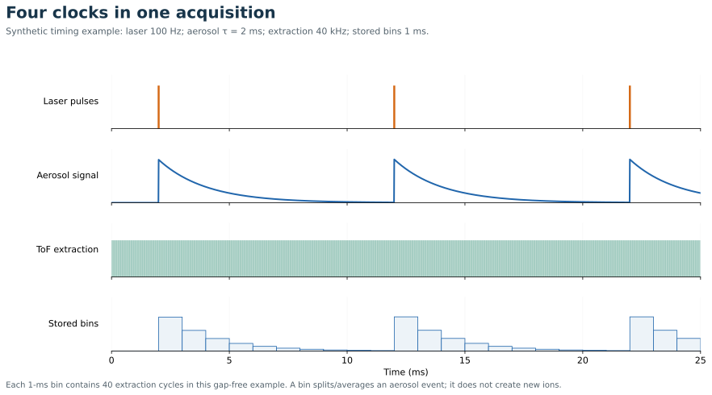

# Simultaneity duty cycle and mapping

[Home](index.md) · [Previous](06-detectors-noise-and-interferences.md) · [Next](08-calibration-and-matrix-effects.md)

**Goal:** connect acquisition specifications to the analytical question. Suggested study time: 12 minutes.

## What “simultaneous” means

A ToF extraction takes a snapshot of a broad range of $m/z$. Those ions arrive at different times within a short flight cycle. Thus the measurement is commonly called simultaneous or quasi-simultaneous on the timescale of the sample transient. It is not a statement that every ion reaches the detector at the same instant.

A quadrupole generally visits selected mass windows sequentially. If the source changes between visits, numerator and denominator can sample different signal amplitudes. Multicollector sector instruments also measure selected isotopes simultaneously; they should not be grouped with all scanning single-collector instruments.

**Synthetic spectral-skew example:** suppose concentration ratio $A/B=1$, but source amplitude decays as $e^{-t/\tau}$. Measuring $A$ now and $B$ after $\delta t$ gives apparent $A/B=e^{\delta t/\tau}$. With $\tau=2$ ms and a 1 ms separation, the apparent ratio is 1.65. Simultaneous sampling greatly reduces this source of error. It does not cancel element-specific transport, interference, or response changes.

Low-dispersion LA experiments have documented artifacts caused by interaction between laser timing and sequential mass acquisition. [Primary study](https://doi.org/10.1016/j.sab.2017.11.007)

## Four different clocks

1. **Laser repetition:** how often a new plume is generated.
2. **Sample response:** how long one plume or particle is spread at the detector.
3. **ToF extraction:** how often an ion packet is sent through the mass analyzer.
4. **Saved integration:** how many extraction spectra are combined into each output point.

A fifth useful clock is total experiment time, including blanks, standards, line turnaround, stage moves, and overhead.

**From the 2026 GSA Connects short course on ToF (instrument settings):** MagneTOF electron-multiplier detection, **2 GS/s** digitization (0.5 ns sampling interval), and a reported **200 kHz** rate (5 μs cycle interval). The role of the 200 kHz clock still needs confirmation; it must not automatically be treated as the saved full-spectrum rate or ion-count limit. See [the course detector specifications and dynamic-range comparison](06-detectors-noise-and-interferences.md#course-instrument-magnetof-detection-and-acquisition-settings).

Nu’s NT08 example describes roughly 26 μs full-spectrum acquisition with accumulated output saved at approximately 80 μs. Its data show how coarser accumulation can merge separate particles and create false apparent multielement events. These are settings in that technical note, not universal rates for every Vitesse configuration. [Official measured example](https://edge.sitecorecloud.io/ametekinc1236b-ametekb19a-productiondcfa-1d17/media/Project/Ametek/nu-instruments/Documents/Vitesse/Notes/App-Note_Vitesse_NT08_Influence-of-spectra-accumulation-speeds.pdf)

## Diagram: Four acquisition clocks

This 25-ms window contains three laser shots, hundreds of extractions, and 25 stored bins; none of those alone defines spatial resolution.

## Three meanings of duty cycle

- **Mass coverage:** does each recorded spectrum contain every mass window allowed by the method?
- **Ion sampling efficiency:** what fraction of the continuous beam actually gets extracted and detected?
- **Recording live time:** what fraction of the experimental time is recorded without acquisition/readout gaps?

An instrument can record spectra continuously across its selected range while sampling only part of the continuous ion beam. “100% of the integration time for every isotope” must not be interpreted as “100% of incoming ions detected.”

For a simple orthogonal accelerator of beam-axis length $\ell$, repetition $f_{\rm ext}$, and incoming axial velocity $v_z$, a rough sampling fraction is

$$D\sim\min\left(1,\frac{f_{\rm ext}\ell}{v_z}\right).$$

This follows from comparing residence time $\ell/v_z$ with the pulse interval. It assumes simple geometry, independent beam segments, and no trapping or bunching. Mass-dependent $v_z$, packet focusing, and geometry complicate actual duty cycle. Early experimental ICP-ToF work explicitly reported limited sampling duty cycle; its numerical performance should not be applied to modern systems. [Myers et al. 1994](https://doi.org/10.1016/1044-0305(94)80019-7)

A longer maximum flight time can limit how soon the next packet is launched without ambiguous overlap. Selecting a narrower mass range can sometimes increase useful duty cycle or improve tuning, but sacrifices broad coverage. Ask what range is retained in the course’s actual method.

## Designing a map

For a line scan,

$$p_x=v_s\Delta t_{\rm output},\qquad
n_{\rm shots/pixel}\approx f_L\Delta t_{\rm output}.$$

These are bookkeeping relations, not guarantees of independent pixels. The beam footprint, pulse placement, transport tail, and reconstruction define the effective sampling volume.

**Synthetic example:** at 100 μm s$^{-1}$ with 5 ms saved bins, nominal along-line pitch is 0.5 μm. With a 5 μm beam, the displayed map is substantially oversampled. Claiming 0.5 μm independent spatial resolution would be misleading.

For pulse-resolved imaging, choose output intervals short enough to characterize the response and shot timing, then integrate a physically meaningful pulse window. Shortening bins does not create more total ions. It redistributes the same counts into noisier bins and increases file/processing load.

**Decision rule:** ToF is particularly attractive when many elements must be registered to the same changing event. If only a few isotopes and the best attainable ratio precision matter, compare against the actual quadrupole, sector, or multicollector performance rather than assuming the broadest spectrum wins.

