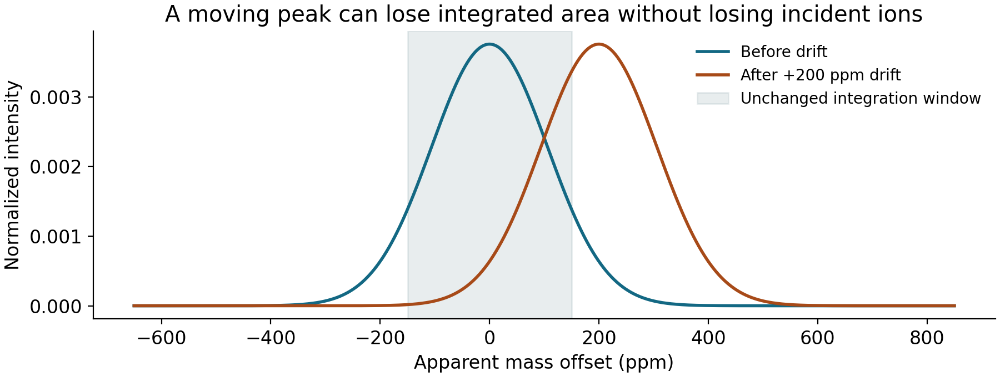

# Tuning, mass drift and interference strategy

**Goal:** turn “tune for sensitivity versus speed” into an experiment with measurable acceptance criteria. This is a proposed reasoning workflow, not a hardware adjustment procedure.

## Tune to a constrained objective

A useful objective is independent-reference precision or recovery for the weakest scientifically necessary channel, subject to adequate resolution, low artifact rate and acceptable spatial response. Maximising one abundant tune ion can worsen saturation, mass discrimination, oxides or useful low-count isotope precision.

Record the introduction mode, representative matrix load, monitored masses, oxide/doubly charged diagnostics if used, background, resolving power, peak shape, saturation status, extraction settings, saved integration and acquisition gaps. The operator's validated method defines how settings may be changed.

A proposed pilot compares a baseline method with one changed factor at a time, then a small joint comparison if factors interact. Hold sample delivery stable while testing optics; hold optics stable while testing saved integration. Repeat a reference at the beginning and end so drift is not mistaken for improvement. Evaluate both calibration standards and an independent reference.

## Tuning target: U/Th near 1 on NIST 610

**Added 16 October 2026. From the 2026 GSA Connects short course on ToF:** tuning should aim for a **²³⁸U⁺/²³²Th⁺ signal ratio near 1 while ablating NIST SRM 610**. A laboratory described in the course re-tunes to this criterion **monthly**.

**Why it works.** The NIST 610/612 glasses contain Th and U at nearly equal concentrations. For NIST 612 the certified values are 37.79 and 37.38 mg kg⁻¹; 610 carries trace elements near 450 μg g⁻¹. [Agilent ICP-MS Journal 88 (2022), tuning article summary](https://icpms.labrulez.com/paper/19881) The two elements are adjacent actinides with similar first ionization energies (Th 6.31 eV, U 6.19 eV) and masses 232 and 238. ²³²Th is 100% of Th and ²³⁸U 99.27% of U. A measured ratio near 1 therefore indicates:

- **Complete vaporization and ionization** in the plasma. Th is more refractory than U, so incomplete particle digestion tends to raise U/Th.
- **Little elemental fractionation** at the ablation site and in transport.
- **No strong mass bias** between these two neighbouring heavy masses.

**What it does not test.** U/Th ≈ 1 does not check sensitivity at low mass, mass bias across the whole spectrum, or the oxide rate. It is commonly paired with a low **ThO⁺/Th⁺** ratio as an oxide-formation and plasma-robustness check. [Agilent: laser ablation for ICP-MS](https://icp-ms.help.agilent.com/en/HowTo/Help/Reference/Laser_Ablation_for_ICP-MS.htm), which gives a ThO/Th target below 1% on NIST 612 and notes that the He flow controls the Th:U bias It also requires an unsaturated signal at both masses. For a ToF, both peaks must also sit inside their integration windows after a mass-calibration update (see the drift calculation below).

**Record at each monthly tune:** U/Th, ThO/Th, sensitivity on a low-, mid- and high-mass isotope, laser fluence and spot size, gas flows, and the date. A trend is more informative than a single pass/fail.

## Mass calibration can drift even when concentration does not

For $m=k(t-t_0)^2$, a small timing displacement at fixed calibration gives

$$\frac{\delta m}{m}\simeq\frac{2\delta t}{t-t_0}.$$

At 20 μs effective flight time, a 2 ns displacement corresponds to 200 ppm apparent mass displacement. At resolving power 4000 the FWHM is 250 ppm. Thus the centroid shifts by about 0.8 FWHM: large enough to compromise a fixed integration window although the number of incident ions may be unchanged. This is a synthetic calculation, not a measured drift specification.

Synthetic equal-area Gaussian peaks show a fixed window losing signal as a peak moves. The plot is a diagnostic model; actual peak shapes and integration algorithms differ.

Monitor clean reference peaks across low, middle and high m/z; examine centroid residuals, widths and integration residuals through time. A common timing-offset error produces a different mass-dependent signature from a scale-factor error. Checking one peak is insufficient to prove that the whole mass axis is correct. Apply the instrument's supported drift correction/recalibration and validate with unused channels or reference intervals where possible.

## Full-spectrum interference handling

The short course specifically discussed interference handling without a collision cell retuned separately for every element. A chosen broad-spectrum reaction/collision condition can help some channels and affect others; absence of per-element tuning does not mean absence of a cell. Nu's Vitesse layout includes a segmented reaction cell. [Manufacturer description](https://www.nu-ins.com/Products/TOF-ICP-MS/Introduction-to-TOF/Vitesse).

Use a hierarchy: assess exact masses and achievable separation; inspect isotope consistency and plausible molecular channels; choose usable alternative isotopes; test a validated reaction/collision condition; use peak deconvolution or interference correction only with supporting measurements. An alternative isotope can reduce overlap while increasing counting uncertainty. Some atomic isobars remain inseparable at the instrument's resolving power. A correction based on another isotope imports uncertainty and assumptions about isotope composition and response.

## Diagnose blanks before subtracting them

| Pattern | Candidate cause | Discriminating test |
|---|---|---|
| All channels drift together | Delivery/plasma/transmission or internal-standard model | Stable delivered reference, total signal and reference recovery |
| One peak loses area while centroid moves | Mass-axis drift / fixed window | Profile spectra and time-resolved centroid |
| Apparent isotope rises with major-element load | Molecular interference / matrix response | Matrix-only material, alternative isotope, mass profile |
| Signal continues after sample ends | Carryover or washout | Extended rinse and isolated-shot/step test |
| Ratios vary only at high intensity | Saturation/gain nonlinearity | Dilution or lower-load reference series |
| Edge smears change with scan direction | Washout / geometry / synchronization | Reversed line scan and boundary response |

Distinguish carrier/plasma background, introduction-system contamination, preparation blanks and sample-dependent interferences. A time-independent gas baseline cannot subtract a molecular interference generated only while ablating the sample.

## One calculation linking tuning to mapping

For stage speed $v_s$, saved interval $\Delta t$ and washout time $\tau$, output pitch is $v_s\Delta t$ while a first estimate of along-track memory is $v_s\tau$. At 100 μm s$^{-1}$, 1 ms bins give 0.1 μm output pitch, but 20 ms washout gives about 2 μm memory, before the spot diameter is included. Saving smaller pixels does not recover a physically mixed sample. Ask for a comparison of **effective boundary width and useful counts**, not only images with smaller rendered pixels.

**Live-session task:** ask the operator to show one tune spectrum, one calibration/drift check, one blank and one unsaturated independent reference. Note which choices constrain each other. See note 21 for the demonstration worksheet.

[Home](index.md)
