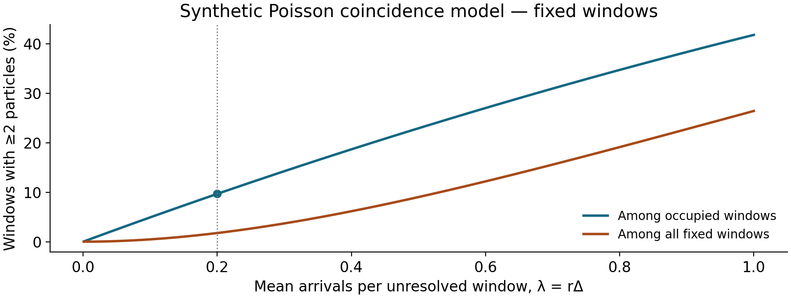

# Single particles, aerosols and non-target screening

**Goal:** understand the additional inference between a short multielement signal and a characterised particle. Complements note 10 and the course's environmental/application session.

## Flight time is not particle transit time

A particle enters the plasma, is vaporised/atomised, and produces an ion cloud extending over multiple ToF extractions. Flight time labels ionic m/z; it does not directly measure particle diameter, aerodynamic size, crystalline phase or original shape. Saved bins can be longer than an extraction and an event can span several bins.

For an event in channel $e$, estimate net integrated signal as $A_e=\sum_{j\in\mathrm{event}}(y_{e,j}-\widehat b_{e,j})$, with counts or rate-to-count conversion stated. Calibration maps that integrated response to element mass. Do not report event peak height as particle mass unless a validated method establishes that relationship.

## Threshold and event construction

Estimate the ionic/background distribution from appropriate blank and quiet intervals, select a threshold with a specified false-positive convention, and test its actual performance in blanks. Join contiguous event bins according to an explicit rule. Use a stated temporal window to associate channels. A common time window can identify candidate multielement events, but cannot prove that only one particle contributed.

Rare-element thresholds matter when screening a full spectrum. If $M$ independent tests each have false-positive probability $\alpha$, the probability of at least one false positive is $1-(1-\alpha)^M$. For 100 ideal independent tests at $\alpha=0.001$, this is about 9.5%. Actual mass-channel tests can be correlated and are repeated across many bins; this example motivates an empirical blank test or a validated multiple-testing method rather than assuming 0.1% overall false positives.

A Gaussian threshold is not automatically appropriate to low-count or analog-derived ToF signals. The Stoll et al. ice study used distribution-dependent detection thresholds and discussed how common detection windows constrain sample comparisons. [Primary example](https://tc.copernicus.org/articles/20/663/2026/tc-20-663-2026.html). Counts, compound counting response and ionic background should be assessed before choosing a threshold rule.

## Coincidence: two particles can look like one

For an ideal Poisson arrival process at rate $r$ and a fixed unresolved window $\Delta$, let $\lambda=r\Delta$. Then

$$P(N\ge2)=1-e^{-\lambda}(1+\lambda),\qquad
P(N\ge2\mid N\ge1)=\frac{1-e^{-\lambda}(1+\lambda)}{1-e^{-\lambda}}.$$

The second expression is the multiple-particle fraction among occupied fixed windows. It is not the fraction for every event-triggered algorithm, whose window definition may differ.

At $r=200$ s$^{-1}$ and $\Delta=1$ ms, $\lambda=0.2$ and about 9.67% of occupied windows contain at least two arrivals in this model. Tenfold dilution gives $\lambda=0.02$ and about 1.0%. Dilution that reduces apparent multielement associations supports a coincidence explanation; aggregation, censoring and changed background must also be checked.

## Particle number, mass and inferred diameter

For a liquid suspension with blank-corrected detected event count $N$, acquisition time $T$, uptake $Q_l$, particle-number transport efficiency $\eta_n$ and above-threshold detection fraction $p_{\mathrm{det}}$, an idealised estimate is

$$C_n=\frac{N}{Q_lT\eta_n p_{\mathrm{det}}}.$$

Do not apply this formula as a blanket correction without knowing what the calibration already includes. For synthetic $N=300$, $T=1$ min, $Q_l=0.20$ mL min$^{-1}$, $\eta_n=0.05$ and $p_{\mathrm{det}}=1$, $C_n=30000$ mL$^{-1}$. If small particles are unobserved and their detection fraction is unknown, report an operational above-threshold number concentration rather than an invented total.

With calibrated element mass $m_e$, known mass fraction $w_e$ and density $\rho$,

$$m_p=m_e/w_e,\qquad d=\left(\frac{6m_e}{\pi\rho w_e}\right)^{1/3}.$$

A synthetic pure-gold particle of 1 fg at 19.3 g cm$^{-3}$ has equivalent spherical diameter about 46.3 nm. An unknown mixed sediment particle has neither known $w_e$ nor known density; its elemental mass vector is more defensible than a single “measured diameter.” The approximate independent-error relation is $\sigma_d/d\simeq\frac13\sqrt{(\sigma_{m_e}/m_e)^2+(\sigma_\rho/\rho)^2+(\sigma_{w_e}/w_e)^2}$, with covariance terms required when assumptions share information.

Particle, dissolved-element and solvent transport efficiencies describe different entities. Their substitution requires validation; they are not interchangeable by definition. [Bolea and Laborda 2024](https://doi.org/10.1016/j.sab.2024.106941).

## What “non-target” can answer

In water/sediment, a full elemental event vector can identify unexpected chemical classes for later confirmation, provided relevant masses were retained, unsaturated and above threshold. It does not identify molecules, biological toxicity or an exposure pathway. Digestion, filtration, suspension preparation and aerosol sampling change the population being studied.

A proposed geoarchaeology example asks whether pigment grains form reproducible chemical groups after contamination and alteration are checked. A proposed geohealth example compares elemental particle classes in matched environmental samples, then validates source/phase assignments independently. These are design exercises, not supplied course case-study results. Elemental association alone is not a provenance proof or a health-risk assessment.

**Minimum validation:** preparation and instrument blanks; known particle mass/number references where available; dissolved standards; dilution/aggregation tests; repeat preparations; stated detection limits by channel; orthogonal microscopy/mineralogy for selected classes. Stoll et al. (2026) combined ICP-ToF particle chemistry with prior Raman/LA information and explicitly described important interpretation limits. That is a useful model of complementary evidence.

[Home](index.md)
